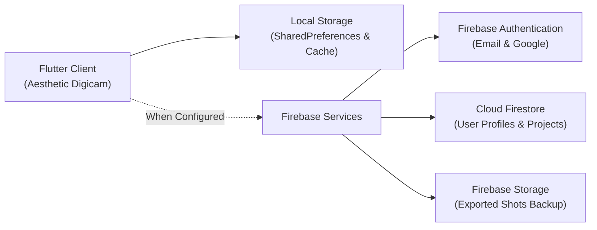

# 🎀 Aesthetic Digicam — Premium Mobile Camera & Photo Editing Studio

<div align="center">


<p align="center">
  <b>Transform ordinary mobile pictures into nostalgic, Instagram-worthy, Pinterest-inspired, Y2K, vintage, coquette, and digital-camera-style photographs.</b>
</p>

</div>

---

## 📸 Overview

**Aesthetic Digicam** is an all-in-one mobile camera, non-destructive photo editor, and creative scrapbook studio designed with the tactile nostalgia of early 2000s Olympus Camedia and Sony Cyber-shot CCD digital cameras.

Instead of looking like a generic photo editor, the app delivers a distinct personality:
- **Y2K Digital Camera & CCD Color Science**: Harsh xenon flash simulation, blown highlights, cool shadows, and glowing orange date stamps.
- **Coquette & Soft Girl Aesthetics**: Silk bows, pearlescent angel glow, rosy cherry blush, and pastel palettes.
- **Pinterest-Worthy Editorial Styling**: Soft beige cafe tones, warm 35mm film grain, polaroid borders, and scrapbook collages.
- **Friction-Free Guest Mode**: Shoot, edit, and export immediately without forced account registration.

---

## ✨ Key Features & Screen Tour

```
┌────────────────────────────────────────────────────────────────────────┐
│                        MAIN NAVIGATION (5 TABS)                        │
├─────────────┬─────────────┬─────────────┬──────────────┬───────────────┤
│   1. HOME   │  2. CAMERA  │ 3. DISCOVER │  4. STUDIO   │  5. MY SHOTS  │
└─────────────┴─────────────┴─────────────┴──────────────┴───────────────┘
```

### 1. 📷 In-App Camera with Retro LCD Viewfinder HUD
- **Real-Time 60fps Filter Previews**: Powered by hardware-accelerated color matrices.
- **Tactile Digicam Viewfinder (OSD)**:
  - Battery charge level (`85%`) with LED indicator.
  - SD Memory card indicator (`SD: 16GB`).
  - Remaining shot counter `[024 / 999]`.
  - Exposure & ISO readout (`ISO 200`, `1/250s`, `F2.8`, `1.0X`).
  - Rule-of-thirds framing grid (toggleable).
  - Glowing orange LCD date stamp burned into bottom corner.
  - Front / rear camera flip, flash modes (Auto, Always, Torch, Off).
  - Tactile metallic shutter button with haptic feedback.

### 2. 🪄 Signature Feature: Mood-to-Photo 1-Tap Recipes
Select your desired aesthetic mood and apply a coordinated recipe in one tap:
1. Coordinated Filter Preset
2. Non-Destructive Adjustments (brightness, contrast, saturation, temperature, grain)
3. Themed Sticker Pack
4. Retro Frame & Customizable Timestamp
5. Contextual Caption Suggestions

| Mood | Filter Preset | Frame & Date Stamp | Sticker Pack | Vibe |
|---|---|---|---|---|
| **Pookie Pink** 🎀 | Pink Dream | Coquette Ribbon + Cyber Pink Date | Silk Bows, Sparkle Hearts | Soft girl sweetness, balletcore |
| **2000s Digicam** 📷 | Y2K Flash | Polaroid + 90s Orange Date | Holographic CD, Flip Phone | Cyber party, memory card nostalgia |
| **Pinterest Girl** ☕ | Soft Beige | Scrapbook Paper + White Minimal Date | Daisies, White Heart | Clean neutral aesthetic, iced matcha |
| **Night Out** 🍸 | Night Flash | 35mm Film + 90s Orange Date | Glow Burst, Cyber Star | Direct xenon flash, moody club shadows |
| **Vintage Memories** 🎞️ | Old Film | 35mm Film + 90s Orange Date | Vintage Rose, Crown | Warm analog 35mm print stock & grain |
| **Soft Girl** 🌸 | Angel Glow | Scrapbook + White Minimal Date | Lavender Butterfly, Angel Wings | Pearlescent dream haze & butterflies |
| **Messy Photo Dump** 📦 | Retro CCD | Scrapbook + 90s Orange Date | Glossy Cherries, Soft Teddy | Uncensored week recaps & candids |
| **Summer Diaries** ☀️ | Golden Hour | Polaroid + 90s Orange Date | Pastel Star, Magic Twinkle | Amber sunset glow, ocean haze |
| **Cafe Aesthetic** 🥐 | Cafe Aesthetic | Vintage Border + White Minimal Date | White Heart, Dream Cloud | Oat milk latte warmth, book chapters |

### 3. 🎨 24 Curated Filter Presets across 5 Collections
- **Digicam**: Y2K Flash, Retro CCD, 2000s Party, Soft Digicam, Cool Flash.
- **Coquette**: Pink Dream, Cherry Blush, Soft Romance, Bow Effect, Angel Glow.
- **Vintage**: Old Film, Warm Memories, Faded Summer, Film Grain, Retro Brown.
- **Night**: Night Flash, City Lights, Party Camera, Midnight Glow.
- **Pinterest**: Soft Beige, Cafe Aesthetic, Golden Hour, Dreamy Light.

### 4. 🛠️ Professional Photo Editor (Studio)
- **Non-Destructive Editing**: Adjustments remain separate from original images.
- **10 Fine-Tuning Sliders**: Brightness, Contrast, Saturation, Exposure, Temperature, Highlights, Shadows, Sharpness, Film Grain, Vignette.
- **Interactive Split Comparison**: Draggable before/after wipe divider with retro OSD labels.
- **20-Step Undo/Redo**: Non-destructive history stack with reset button.
- **High-Resolution Export**: High-fidelity export pipeline burning optional date stamps directly to disk.

### 5. 🎀 Creative Scrapbook Studio & Multi-Touch Stickers
- **10 Sticker Categories**: Bows, Hearts, Stars, Cherries, Flowers, Teddy Bears, Butterflies, Sparkles, Doodles, Y2K Decorations.
- **Multi-Touch Manipulation**: Freeform drag, corner resize/rotate knobs, bring-to-front layer order, delete.

### 6. 📅 Retro Frames & Customizable Date Stamps
- **Frames**: Classic Polaroid with caption margin, 35mm Film with perforations, Scrapbook torn paper, Coquette Ribbon, Y2K Chrome.
- **Date Stamps**: 90s Olympus Glowing Orange, Pinterest Minimal White, Green Camcorder LED, Cyber Pink.
- **Customizable**: Position cycler (BR, BL, TR, TL), custom date/time picker, and clear distinction between verified EXIF metadata and decorative timestamps.

### 7. 📦 Collage & Photo Dump Maker
- **Layouts**: 2-photo horizontal/vertical split, 3-photo spotlight trio, 4-grid classic, magazine editorial, scrapbook scattered dump.
- **Customizable Canvas**: Pastel palette background selector, spacing slider (0–20px), corner rounding slider (0–28px).

### 8. ✍️ AI Caption Generator
- **10 Tone Styles**: Cute, Funny, Sarcastic, Pinterest, Y2K, Mysterious, Confident, Minimal, Travel Diary, Best Friends.
- **Hybrid Engine**: Supports secure backend proxy endpoints with a built-in offline aesthetic quote library. One-tap copy to clipboard and favorites.

### 9. 💾 My Shots & Personal Gallery
- Filter by All Shots, Exported Edits, Saved Projects, and Studio Samples.
- Full-screen viewer with instant system sharing (`share_plus`) and non-destructive re-editing.

---

## 🎨 Design System & Color Palette

The UI adopts a soft pastel aesthetic accented with vintage metallic camera hardware:

| Color Token | Hex Code | Visual Application |
|---|---|---|
| **Blush Pink** | `#F8C8DC` | Primary buttons, active highlights, badges |
| **Soft Pink** | `#FCE4EF` | Subtle surface cards, chip containers |
| **Lavender** | `#DCD6F7` | Secondary accents, tags, collage backgrounds |
| **Cream** | `#FFF8F0` | Warm vintage scaffold background, paper frames |
| **Deep Plum** | `#503047` | High-contrast typography, primary dark buttons |
| **Retro Orange** | `#FF7A00` | Glowing 90s digital camera LCD date stamps |
| **LED Green** | `#4ADE80` | Camcorder OSD status, battery level, verified badges |
| **LCD Cyan** | `#38BDF8` | Camera viewfinder HUD telemetry |

---

## 🚀 Getting Started

### Prerequisites
- **Flutter SDK**: `^3.44.0` (or higher)
- **Dart SDK**: `^3.12.0` (or higher)
- **JDK**: Java 17 or 21 (configured for Android builds)
- **Android SDK**: API 35/36 with build tools `35.0.1`+

### 1. Clone & Install Dependencies
```bash
git clone https://github.com/your-username/aesthetic_digicam.git
cd aesthetic_digicam

# Fetch Flutter packages
flutter pub get
```

### 2. Generate Aesthetic Studio Sample Assets
The app includes a built-in asset generator that creates high-resolution sample photos for immediate offline testing:
```bash
dart run tool/generate_sample_assets.dart
```

### 3. Run the App
```bash
# Launch on connected Android device or emulator
flutter run

# Or run on Windows desktop / Web
flutter run -d windows
flutter run -d chrome
```

---

## 🔥 Firebase & Database Configuration

Aesthetic Digicam is architected with a **dual-mode backend**:
1. **Offline-First / Guest Mode (Default)**: Runs without requiring any immediate Firebase setup. All presets, photo projects, favorites, and exported shots persist locally via `SharedPreferences` and app documents storage.
2. **Connected Cloud Mode**: When Firebase is linked, user authentication (Email, Google), Cloud Firestore sync, and Firebase Storage cloud backups are automatically enabled.



### Step 1: Connect your Firebase Project

1. Install the [Firebase CLI](https://firebase.google.com/docs/cli) and [FlutterFire CLI](https://firebase.flutter.dev/docs/cli/):
   ```bash
   npm install -g firebase-tools
   firebase login
   dart pub global activate flutterfire_cli
   ```

2. Generate your platform-specific Firebase configuration:
   ```bash
   flutterfire configure --project=YOUR_FIREBASE_PROJECT_ID
   ```
   This automatically updates [`lib/firebase_options.dart`](file:///d:/ALL%20PROJECTS/personal_digicam/lib/firebase_options.dart) with your project's API keys and app IDs.

3. Download your Android `google-services.json` from the Firebase Console and place it at:
   ```
   android/app/google-services.json
   ```

### Step 2: Cloud Firestore Database Schema

The Firestore database organizes data hierarchically with user-isolated security:

```
firestore/
├── users/
│   └── {userId}/
│       ├── email: string
│       ├── displayName: string
│       ├── photoUrl: string?
│       ├── lastActiveAt: timestamp
│       │
│       ├── projects/
│       │   └── {projectId}/
│       │       ├── id: string
│       │       ├── title: string
│       │       ├── filterId: string
│       │       ├── filterIntensity: number
│       │       ├── brightness: number
│       │       ├── contrast: number
│       │       ├── saturation: number
│       │       ├── temperature: number
│       │       ├── grain: number
│       │       ├── vignette: number
│       │       ├── rotationDegrees: number
│       │       └── lastModified: timestamp
│       │
│       └── presets/
│           └── {presetId}/
│               ├── name: string
│               └── settings: map
│
└── public_filters/
    └── {filterId}/
        ├── name: string
        ├── category: string
        └── matrix: array<number>
```

### Step 3: Deploy Security Rules & Indexes

The project contains pre-configured security rules restricting write/read access exclusively to authenticated users:

- [`firestore.rules`](file:///d:/ALL%20PROJECTS/personal_digicam/firestore.rules): User-specific isolation for documents and subcollections.
- [`storage.rules`](file:///d:/ALL%20PROJECTS/personal_digicam/storage.rules): Grants read/write access solely to the authenticated owner's `users/{userId}/**` cloud directory.
- [`firebase.json`](file:///d:/ALL%20PROJECTS/personal_digicam/firebase.json): Firebase CLI deployment mapping.

Deploy both rules to your live Firebase project with a single command:
```bash
firebase deploy --only firestore:rules,storage
```

---

## 🧪 Testing & Code Quality

Verify the codebase with Flutter's official testing and static analysis tools:

```bash
# Static analysis (0 errors, 0 warnings)
flutter analyze

# Run unit and widget test suite
flutter test
```

---

## 📁 Project Architecture & Directory Structure

```
lib/
├── firebase_options.dart          # Multi-platform Firebase configuration
├── main.dart                      # App entrypoint, theme bootstrap & orientation lock
│
├── core/
│   ├── constants/
│   │   ├── app_colors.dart        # Blush, lavender, cream, retro orange & silver tokens
│   │   └── app_typography.dart    # Playfair Display, Plus Jakarta Sans, VT323 LCD fonts
│   ├── theme/
│   │   └── app_theme.dart         # Material 3 light & dark theme specifications
│   ├── services/
│   │   ├── firebase_service.dart  # Resilient Firebase initializer with offline fallback
│   │   ├── auth_service.dart      # Email, Google, and Guest mode authentication
│   │   ├── firestore_service.dart # Cloud Firestore sync for projects and presets
│   │   ├── firebase_storage_service.dart # Optional photo backup service
│   │   ├── image_processing_service.dart # Color matrices, grain, vignette, and export
│   │   ├── storage_service.dart   # SharedPreferences local persistence
│   │   ├── permission_service.dart# Explanatory camera & photo permission prompts
│   │   └── ai_caption_service.dart# 10-tone aesthetic caption engine with offline quotes
│   └── utils/
│       └── haptic_feedback.dart   # Tactile shutter, dial, and tap feedback
│
├── data/
│   ├── models/
│   │   ├── filter_preset.dart     # 4x5 Color filter matrices and adjustment defaults
│   │   ├── photo_project.dart     # Non-destructive project model with undo/redo
│   │   ├── sticker_item.dart      # Interactive placed sticker model (drag/scale/rotate)
│   │   ├── frame_style.dart       # Polaroid, 35mm film, scrapbook, and date configs
│   │   ├── collage_layout.dart    # Multi-photo grid and dump layout models
│   │   └── mood_preset.dart       # Coordinated 1-tap aesthetic recipe definitions
│   └── repositories/
│       ├── filter_repository.dart # All 24 presets across 5 aesthetic categories
│       ├── sticker_repository.dart# 10 sticker packs (Bows, Hearts, Stars, etc.)
│       ├── mood_repository.dart   # 9 signature Mood-to-Photo recipes
│       └── sample_photos_data.dart# Curated high-res studio test assets
│
└── presentation/
    ├── navigation/
    │   └── main_navigation_screen.dart # 5-tab responsive navigation bar
    ├── screens/
    │   ├── home/
    │   │   └── home_screen.dart        # Featured collections, quick launch, inspo
    │   ├── camera/
    │   │   ├── camera_screen.dart      # Full-screen camera with real-time preview
    │   │   └── widgets/
    │   │       ├── digicam_hud.dart    # Retro LCD indicators, ISO, battery, date
    │   │       └── filter_carousel.dart# Horizontal filter carousel & intensity
    │   ├── discover/
    │   │   └── discover_screen.dart    # Curated aesthetic collections & favorites
    │   ├── studio/
    │   │   ├── studio_screen.dart      # 10-slider editor with undo/redo & export
    │   │   └── widgets/
    │   │       └── before_after_viewer.dart # Interactive split wipe comparison
    │   ├── stickers/
    │   │   └── sticker_studio_screen.dart # Interactive multi-touch canvas
    │   ├── frames/
    │   │   └── frames_datestamps_screen.dart # Polaroid, 35mm, and date stamp picker
    │   ├── collage/
    │   │   └── collage_maker_screen.dart # Multi-photo grids & background palettes
    │   ├── mood/
    │   │   └── mood_to_photo_screen.dart # 1-tap Mood-to-Photo recipe studio
    │   ├── captions/
    │   │   └── caption_generator_screen.dart # AI tone generator & copy clipboard
    │   ├── shots/
    │   │   └── my_shots_screen.dart    # Personal photo gallery & project manager
    │   └── auth/
    │       └── auth_sheet.dart         # Modal auth sheet (Email, Google, Guest)
    └── widgets/
        ├── aesthetic_button.dart       # Glossy pill buttons & metallic shutter button
        ├── aesthetic_card.dart         # Rounded pastel container cards
        ├── retro_date_stamp_widget.dart# Stylized LCD digital date stamp
        └── sticker_painter.dart        # Draggable, rotatable, scalable sticker widget
```

---

## 📄 License

This project is licensed under the MIT License — see the [LICENSE](LICENSE) file for details.
